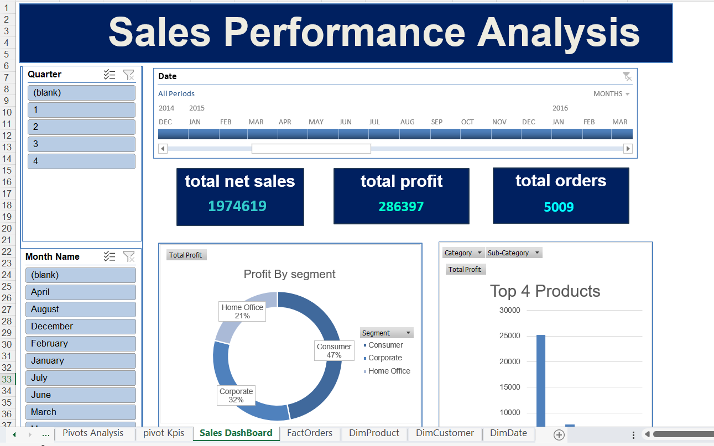

# Excel Sales Performance Dashboard

## Project Overview

An interactive Excel dashboard designed to analyze sales performance and provide a clear overview of revenue, profitability, orders, customer segments, and top-performing products.

## Dashboard Preview

  

## Key Performance Indicators

The dashboard provides the following key metrics:

- **Total Net Sales**
- **Total Profit**
- **Total Orders**

## Analysis & Visualizations

The dashboard includes:

- Profit distribution by customer segment
- Top 4 products by profit
- Quarterly analysis
- Monthly analysis
- Date-based filtering
- Interactive slicers and timeline filters

## Tools & Technologies

- Microsoft Excel
- PivotTables
- PivotCharts
- Slicers
- Timeline Filters
- Data Analysis

## Key Insights

The dashboard allows users to explore sales performance across different periods and customer segments and identify the products and segments contributing most to overall profitability.

## Project Goal

The goal of this project is to transform sales data into an interactive and easy-to-understand dashboard that supports data-driven analysis and business decision-making.

## Author

**Fatma Elboghdady**

Data Analyst | Data Instructor
